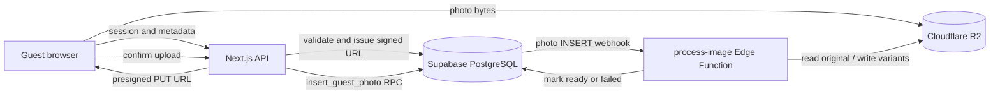

# Memora / Event Photo Hub: Engineer Handoff

## Purpose

Memora is a mobile-first event photo-sharing app. A host creates an event and shares its QR code or link. Guests can view a permitted gallery and upload photos without creating accounts. Hosts manage their events and can pay to unlock enlarged previews and original-file downloads.

This document describes the implementation present in this checkout. It is a source-code overview, not confirmation that every migration, credential, external integration, or production setting is current.

## Stack and Runtime

- **Web app:** Next.js 15 App Router, React 19, TypeScript, Tailwind CSS.
- **Authentication and database:** Supabase Auth and PostgreSQL. Row Level Security (RLS) is a primary authorization boundary.
- **Object storage:** Cloudflare R2, accessed server-side using S3-compatible APIs and short-lived signed URLs.
- **Image processing:** Supabase Edge Function (`process-image`, Deno), invoked by a Supabase Database Webhook when a photo row is inserted.
- **Hosting:** Configured for Netlify; the project docs also describe Vercel.

The Next.js app handles pages and API routes. Original image bytes go directly from the guest's browser to R2; they do not pass through a Next.js upload handler.

## Frontend and User Journeys

| Route | Purpose |
| --- | --- |
| `/` | Marketing/home page, event-code or event-link lookup, and a list of recent public/shared events. |
| `/e/[code]` | Guest event landing page, consent step, photo selection, upload progress, retries, and success state. |
| `/gallery/[code]` | Event gallery with favourites, lightbox, selection, event management actions where authorized, and an add-photos link while uploads are open. |
| `/signup`, `/login`, `/forgot-password`, `/reset-password` | Host authentication and password recovery through Supabase Auth. |
| `/dashboard` | Signed-in host's events, summary counts, and create-event form. Admins can also reach this view. |
| `/dashboard/events/[code]` | Host event settings, status controls, QR code, printable poster, share links, and download-entitlement status. |
| `/admin/**` | Site-operator console for cross-client event administration and staff functions. Requires an authenticated user; admin operations additionally check the admin role. |
| `/client/**` | Legacy collaborator/staff area retained in routing. |
| `/privacy` | Privacy information linked from guest-facing pages. |

The guest flow is implemented as client-side screen state on `/e/[code]`: landing → consent → upload. The gallery is separate navigation. The guest upload component accepts camera or library selections, validates and trims batches, shows per-photo status, and supports retrying failed uploads. The current per-event guest quota is enforced by the backend; the picker batch maximum is a separate limit.

The gallery reads only processed, non-hidden photos for its normal guest view. Hosts/collaborators have management actions subject to authorization. Viewing a gallery and downloading originals are intentionally separate permissions.

## Backend Surface

### API routes

The route handlers live under `src/app/api`:

- **Guest upload:** `POST /api/guest/session`, `POST /api/upload/request-url`, `POST /api/upload/confirm`.
- **Public event discovery:** `GET /api/public/events`.
- **Host events:** `/api/events` and `/api/events/[code]` for owner-scoped list/create/read/update operations; `/api/events/[code]/checkout` creates a pending payment record.
- **Admin events:** `/api/admin/events` and `/api/admin/events/[code]` for staff event operations, settings, and `/mark-paid` for staff-confirmed payment.
- **Photos and downloads:** favourite, delete, and single-photo download routes under `/api/photos/[id]`; ZIP downloads under `/api/download/zip`.
- **Supporting endpoints:** `/api/account` creates/resolves the signed-in user's client profile; `/api/packages` returns package options.

For exact methods and validation, inspect each route handler. Owner routes generally use a session-bound Supabase client so RLS decides which rows are visible or editable. Admin and guest workflow routes use the server-only service-role client where required; handlers and database functions must provide the narrow checks because that key bypasses RLS.

### Main database entities

- `clients`: host/client profiles associated with Supabase Auth users.
- `events`: event code, owner, status, visibility, upload settings and counters, optional collaborator/package, download unlock time, branding, and retention deadlines.
- `photos`: metadata and object keys, processing state, moderation/favourite flags, and guest-session association. Image bytes are stored in R2, not PostgreSQL.
- `guest_sessions`: opaque, event-scoped anonymous guest tokens and upload counters. No direct guest table access is granted.
- `collaborators`: optional event-level collaborator relationship.
- `packages` and `payments`: package limits/prices and payment records used for original-download entitlement.
- `rate_limit_buckets`: shared request-window counters used by the distributed rate limiter.

The core event states are active, closed, and archived. Visibility values are private, shared, and public. Photos move through processing, ready, failed, and deleted states.

### Authorization and security model

- Guests do not sign in. They resolve events with a non-sequential event code and upload through server routes plus narrow PostgreSQL RPCs.
- Hosts authenticate with Supabase Auth. Their `clients` profile is created by a database signup trigger and/or the idempotent `create_own_client_profile()` function. Authenticated event access is scoped by RLS.
- Site admins are identified by the `role: admin` app-metadata claim. A normal authenticated account is not automatically an admin.
- Collaborators are assigned to an event and have a narrower scope than admins.
- The Supabase service-role key and R2 credentials are server-only. The Supabase client factories are in `src/lib/supabase/`; the elevated factory and R2 client use `server-only` guards.
- Database functions enforce high-risk invariants, including guest photo insertion, event limits, commercial-field protection, payment marking, and upload rate limits. Service-only RPC privileges must be revoked and verified for both `anon` and `authenticated`, not just `PUBLIC`.
- Download authorization is centralized in `src/lib/auth/downloadEntitlement.ts`: admins can download; event owners can download after the event is paid/unlocked; guests and unpaid owners cannot.

## Guest Upload and Processing

1. The guest page resolves an event using `get_event_for_upload()`. Event status, upload expiry, and event photo capacity control whether new uploads are accepted.
2. The browser requests `/api/guest/session`. The server creates or reuses a long, opaque token scoped to that event and returns it in an HttpOnly cookie. The database tracks the guest's quota; callers cannot choose or reset the counter.
3. For each file, the browser requests `/api/upload/request-url` with file metadata. The server checks the event, guest session, rate limit, file type, and size, then generates the photo ID and R2 object path and returns a short-lived presigned PUT URL.
4. The browser uploads the bytes directly to R2 using that URL.
5. The browser calls `/api/upload/confirm`. The server verifies the event-scoped session, expected object path, and R2 object's actual size and content type. It calls `insert_guest_photo()` with the HttpOnly session token.
6. `insert_guest_photo()` rechecks event state, expiry and event capacity, allowed MIME type, object path, and guest quota transactionally under database row locks. A confirmed photo row starts in `processing` state. Failed confirmation attempts trigger best-effort deletion of the unconfirmed R2 object.
7. The photo INSERT webhook invokes `supabase/functions/process-image`. The function reads the original from R2, creates gallery and thumbnail WebP variants, writes them to R2, and calls the service-only `mark_photo_processed()` RPC. Errors are recorded through `mark_photo_failed()`; the gallery can refresh while processing is underway.



## Gallery, Retention, and Payments

- `visibility` controls who may view a gallery. Private galleries require an authorized owner, collaborator, or admin session; shared/public galleries can be viewed by link/public route subject to expiry.
- Migration `0019_event_retention_and_v1_limits.sql` adds `uploads_close_at` and `gallery_expires_at`, with defaults of 7 and 30 days after event creation. Upload resolution checks the upload deadline; gallery access checks its expiry. Original-file retention is distinct from gallery-view expiry.
- Photo thumbnails and gallery variants are used for gallery display; original files remain behind download authorization and signed access.
- A host checkout request creates a pending payment only. No payment gateway or provider webhook is implemented in this checkout. The current documented path is EFT followed by staff confirmation through the admin mark-paid route. The database's `mark_event_paid()` function controls the unlock and is service-role-only.
- The 50-photo package is listed at R50; other package prices are null and checkout refuses to treat a missing price as free. Confirm package data before enabling sales.

## Migrations and Current-State Cautions

Migration files currently checked into `supabase/migrations` include `0001`–`0006`, `0009`–`0013`, and `0017`–`0020`. There are numbering gaps (`0007`, `0008`, `0014`–`0016` are not present in this checkout). Do not assume this directory alone is a complete clean-install history or blindly apply it to a database with a different migration ledger. Compare the target project's `supabase_migrations.schema_migrations` and live schema first, then reconcile with the database owner.

The current signup repair is [migration 0020](../supabase/migrations/0020_repair_host_signup_trigger.sql). It removes the obsolete curator trigger/function and installs the client-profile trigger. If signup fails with a Supabase Auth database error, check whether the target database has applied this repair and verify the trigger and function there.

Several older documents conflict with current source or with one another. In particular, older README text predates the server-enforced guest quota in migration `0012`; the guest-session route currently has no visible call to the shared distributed rate limiter even though the deployment runbook describes one; and [R2_SETUP.md](R2_SETUP.md) describes public variant URLs while the current gallery page requests signed URLs for gallery/thumbnail paths. Verify actual deployed behavior and intended policy before changing production settings. Production migration status, R2 credentials/CORS, webhook configuration, and deployment variables are not proven by this source checkout.

## Local Development and Verification

1. Install Node.js `>=18.18` and run `npm install`.
2. Copy `.env.example` to `.env.local` and supply the Supabase and R2 values. Keep service-role and R2 secret values out of client code and version control.
3. Configure Supabase migrations, Auth, and the `photos` INSERT Database Webhook to the `process-image` Edge Function. Configure an R2 bucket, scoped server token, public/signed variant access as intended, and CORS for the app origin.
4. Run `npm run dev`; use a non-production event for testing the guest and host flows.

Useful checks:

```bash
npm run preflight
npm run typecheck
npm run lint
npm run verify:db
npm run build
```

`npm run verify:db` runs Postgres-in-WASM (PGlite) harnesses for migration behavior, client RLS, commercial-field protections, function privileges, collaborators, and guest-session quotas. It is valuable regression coverage, but it is not a live Supabase/R2 integration test. See [scripts/verify/README.md](../scripts/verify/README.md), [SUPABASE_SETUP.md](SUPABASE_SETUP.md), and [R2_SETUP.md](R2_SETUP.md).

## Known Product / Engineering Follow-ups

- Choose and integrate a payment provider, including webhook signature verification and idempotent payment confirmation; set and review package prices.
- Reconcile the checked-in migration history with the target Supabase project's applied history and confirm migration `0020` is live where required.
- Review rate limiting on `/api/guest/session`; the upload URL endpoint already calls the shared Supabase-backed limiter.
- Resolve whether gallery/thumbnail variants should use public URLs or signed URLs and align code, R2 access, CORS, and documentation.
- Confirm retention/deletion policy for original R2 objects, abandoned uploads, and expired galleries; database deadlines do not by themselves prove object lifecycle cleanup.
- White-label branding fields are present and read on the guest surface, but the full host configuration UI is not complete.
- Video uploads, AI features, reporting/moderation workflows, and live gallery updates are not implemented in the current documented scope.
- Re-run end-to-end mobile browser tests against a real Supabase/R2 environment. The PGlite and build checks do not exercise camera permissions, real presigned uploads, CORS, webhook delivery, or deployed credentials.